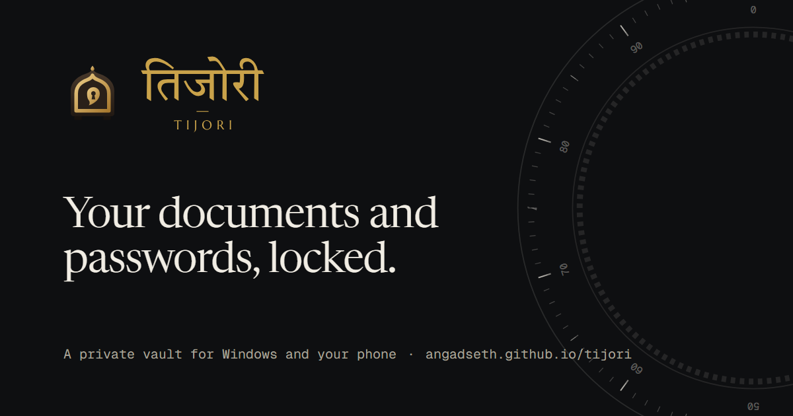

  

<h1 align="center">Tijori</h1>

<b>Your documents and passwords, locked.</b> 
A free, private vault for Windows and your phone.

  <a href="https://angadseth.github.io/tijori/"><b>Website</b></a> ·
  <a href="https://angadseth.github.io/tijori/download.html"><b>Download for Windows</b></a> ·
  <a href="https://angadseth.github.io/tijori/app/"><b>Open on phone</b></a> ·
  <a href="https://github.com/angadseth/tijori/releases/latest">Releases</a>

---

Tijori reads, names and files your documents, keeps your passwords and cards, and encrypts
everything on your own device. No account, no tracking. It syncs through **your own Google
Drive**, end-to-end encrypted, so the same vault opens on your PC and your phone.

## Download

| | File |
|---|---|
| Windows installer | [Tijori_4.0.1_x64-setup.exe](https://github.com/angadseth/tijori/releases/download/v4.0.1/Tijori_4.0.1_x64-setup.exe) |
| Windows portable | [Tijori.exe](https://github.com/angadseth/tijori/releases/download/v4.0.1/Tijori.exe) |
| Phone (Android / iPhone) | Open [angadseth.github.io/tijori/app](https://angadseth.github.io/tijori/app/) and tap **Add to Home screen** |

Checksums are in `SHA256SUMS.txt` on each release.

## What it does

- **Documents:** drop any file (PDF, Office, photos, video). Tijori reads it, names it and files it.
  Aadhaar front and back are paired. Family members get their own folders.
- **Passwords and cards:** logins, bank cards, Wi-Fi and IDs, each with the fields it needs.
- **Ideas board:** notes with photos, voice and video; voice-to-text runs offline.
- **Encryption:** everything is encrypted on your device with your master password.
  Google sign-in alone can never open the vault.

Read more on the [security page](https://angadseth.github.io/tijori/security.html) and the
[privacy page](https://angadseth.github.io/tijori/privacy.html).

## About this repository

This repository hosts the Tijori website and the phone app (GitHub Pages) and the Windows
releases. The app source is kept in a separate repository.

---

Made by Angad Jangir, IIT Madras

